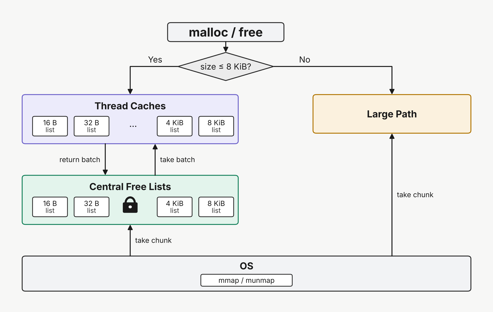
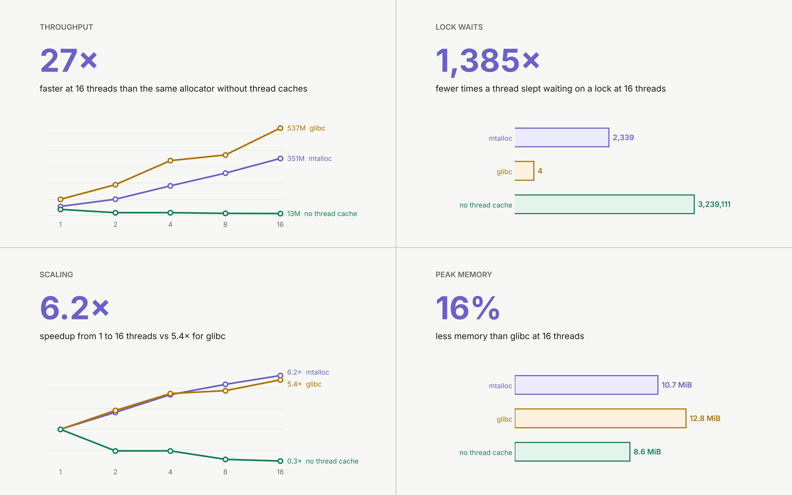

# mtalloc

A size-class multithreaded allocator written in C++20. Includes thread caching, concurrency tests, and benchmarking against glibc.

## Architecture

<p align="center">
  
</p>

## Project Structure

``` 
mtalloc/
├── Makefile
├── run_tests.sh
├── run_bench.sh
├── .gitignore
├── .gitattributes
├── LICENSE
├── README.md
├── src/
│   ├── shared.h
│   ├── api.cpp
│   ├── thread_cache.cpp
│   ├── central.cpp
│   ├── large.cpp
│   └── os.cpp
├── tests/
│   ├── check.h
│   ├── api_test.cpp
│   ├── mt_test.cpp
│   ├── cross_thread_test.cpp
│   ├── churn_test.cpp
│   ├── fork_test.cpp
│   └── programs.sh
├── bench/
│   └── bench.cpp
├── results/
│   └── benchmark.csv
└── docs/
    └── figures/
        ├── architecture.png
        ├── benchmark.png
        ├── throughput.png
        ├── speedup.png
        ├── lock_waits.png
        └── memory.png
```

## Prerequisites

- Linux (x86-64)
- GCC 10 or newer (C++20)
- make

## Setup

Clone and build:

```bash
git clone https://github.com/MohamedFouad132/mtalloc.git
cd mtalloc
make
```

This builds `libmtalloc.so`. Run any program with it through `LD_PRELOAD`:

```bash
LD_PRELOAD=./libmtalloc.so python3
LD_PRELOAD=./libmtalloc.so git status
```

## Tests

```bash
./run_tests.sh
```

| Test | What it checks |
|---|---|
| `api_test` | Every public function and its edge cases |
| `mt_test` | 8 threads doing random allocations and frees at the same time |
| `cross_thread_test` | Slots allocated on one thread and freed on another |
| `churn_test` | Memory usage doesn't spike as thousands of short-lived threads exit |
| `fork_test` | Forking while other threads allocate never deadlocks |

## Benchmarks

```bash
./run_bench.sh
```

Benchmarks glibc, mtalloc and mtalloc (no caches) at 1, 2, 4, 8 and 16 threads.

Results go to `results/benchmark.csv`.

## Results

<p align="center">
  
</p>

> **Note:** glibc is still faster in raw throughput (1.8× on one thread and 1.5× at 16), but mtalloc scales better as threads are added.

## Key Findings

- **Thread caches make mtalloc 12.6× faster on average** than the same allocator without them. This is primarily because of reduced lock contention.
- **Thread caches use 9% more peak memory on average.** Each cache holds spare slots other threads can't use.
- **glibc is still 1.7× faster on average.** 

## Limitations

- Memory for small allocations is never returned to the OS once used.
- Large allocations call `mmap` and `munmap` every time with no reuse.
- Alignments of 64 KiB and above aren't supported.

## License

[MIT](LICENSE)
